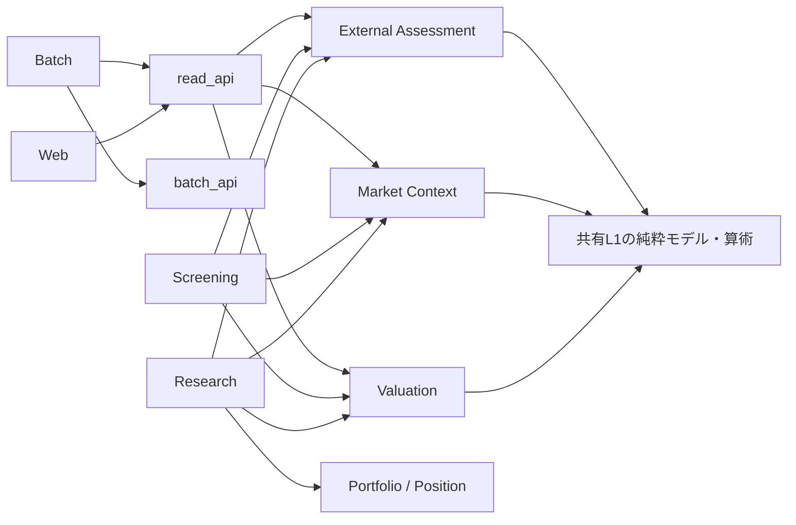

# Architecture

Baibai Loopの目的は、割安銘柄を発見し、割安幅と条件付き収益を評価し、根拠を伴う一銘柄ずつの売買提案へつなげることである。実売買、提案の採用、注文・約定の確認は人間が行う。

この文書は設計上の境界・依存・保存責務を所有する。用語と成果物の関係は[domain-language](./domain-language.md)、実契約は[reference](./reference/README.md)、操作は[各skill](../.agents/skills/)と[batch運用](../batch/OPERATIONS.md)が所有する。Issueは意思決定と移行の証拠であり、現行仕様をコメントだけに置かない。以下に最終境界を示し、実装との差分は[移行状況](#migration-status)にまとめる。

<a id="information-layers"></a>

## 1. 分析領域と情報層

業務の横方向には三つの分析領域がある。

| 領域 | 所有する問いと結果 |
| --- | --- |
| Valuation | 自分たちの仮定で企業の価値・割安幅・条件付き収益を測る |
| Market Context | 経済・金利等の環境と市場全体・業種・個別相対の状態を、対象日と比較母集団を揃えて測る |
| External Assessment | 誰が何を提示したかを出所付きで記録・比較する。実際の大衆行動を測定したとは呼ばない |

縦方向には情報の役割がある。

| 層 | 内容 |
| --- | --- |
| L1 観測 | 原典から取得した値と、その出所・時点・被覆・欠測 |
| L2 機械分析 | 固定した入力と規則から再現できる決定的な計算・比較 |
| L3 AI | 解釈、仮定の設定、有限調査、判断、条件付き評価・提案 |

AIが置く仮定を決定的算術で計算しても、仮定は観測にならず、結果は条件付き見積りである。各領域でL1/L2/L3の責務を識別するが、九つの空package、三DB、三サービスを作る区分ではない。共有するL1の純粋モデルや小さな算術にも意味の所有者を保つ。

判断用入力は値に加え、出所、対象・観測・取得・公開の時点、欠測と比較上の制約を持つ。転載を独立票と数えず、異種のrating・目標株価・Quants scoreを単一投票に潰さない。三領域の総合scoreや自動注文を追加しない。

<a id="layers"></a>

## 2. 最終依存境界



図の矢印は業務入力・読取の依存を示す。三領域は相互やResearch・Screening・UIへ逆依存しない。Researchは領域の公開読取入口を呼び、UI向け`read_api`を内部業務入力にしない。Screeningは三領域の出力を組み立て、母集団・候補探索・Review Setを所有する。ResearchはTriage、有限調査、Thesis/Reviewと売買提案を所有する。

Webのengine入口は`read_api`、Batchは`batch_api`/`read_api`である。Batchは判断や書込条件を複製せず、domainの既存serviceへ委譲する。domainが観測の意味・重複・書込条件を所有し、SQL/取得adapterが共有`storage`を使う。共有storageは純粋契約と技術helperだけを参照し、分析・AI・UI・取得serviceへ依存しない。純粋な型・算術は保存や取得を読み込まない。

Portfolio/Positionは確認済み取引と保有を所有し、Researchへ逆依存しない。確認済みbroker factを扱うCLIの合成入口は保存済み判断の参照解決を渡し、Positionのdraft組立・事実記録へ委譲する。参照解決と取引事実の記録を別の責務として保つ。Operation/taskは進行状態であり、投資評価や取引事実を代行しない。

実装は単一distributionの`baibai_engine`、表示を担う`baibai_web`、運用を担う`baibai_batch`で構成する。依存制約の厳密な範囲と公開CLIの合成例外は[import-linter設定](../pyproject.toml)が検査する。

<a id="repository-map"></a>

## 3. モデル・入力・出力の所有

以下は意味の所有と公開境界の対応である。保存場所は領域数に合わせず、field・SQL・計算式はリンク先の実契約へ委譲する。

| 所有 | 主モデル・成果物 | 入力と出力 | 保存・公開入口 |
| --- | --- | --- | --- |
| Valuation | FinancialSnapshot、倍率/機械ER/FV、ER較正文脈、Projection、条件付き収益 | 財務・価格・配当の純粋L1入力とTTM規則から財務/倍率を計算し、仮定から価値/収益を測る。機械anchorと企業固有Projectionを区別 | L2機械値はSecurity Analysis、企業固有前提はThesisの一部。領域読取と外向け`read_api/valuation`・`read_api/er_calibration_context`。[Valuation](./reference/valuation-metrics.md#machine-valuation)・[Thesis](./reference/thesis.md#scenario-arithmetic) |
| Market Context | Market Snapshot、Security Market Context、公式benchmark観測、Macro Reading/Context | 経済・金利・市場・業種・個別の保存観測から環境・価格状態・信用需給と相対値を返す | 観測はmarket/lake・macro、既存Macro Contextはapplication。領域読取と外向け`read_api/market_context`。[Market Context](./reference/macro.md#market-context-reads) |
| External Assessment | 提示値の受領履歴、出所別比較・欠測 | 媒体別のモデル価格・rating・Quants・TradingViewを出所/尺度/期間付きで扱う | typed L1はmarket/lake、比較は保存入力から再計算。`external_assessment/query`、外向け`read_api/external_assessment`とCLI。[入力](./reference/data-sources.md#external-assessment)・[読取](./reference/market-lake.md#external-assessment-query) |
| Screening | Security Analysis、Nomination、Review Set | 三領域の結果を組み立て、母集団と候補探索を適用 | runs store。`screening`の公開入口と`batch_api`。[Screening](./reference/screening-runtime.md) |
| Research | Triage、Research Set、Thesis/Review、CAA、Position Review提案 | 領域結果・出典・保有を調べ、一銘柄ずつの判断/提案を作る | applicationの判断履歴。`research/triage`・`research/workspace`・既存service。[Research](../.agents/skills/research/SKILL.md) |
| Portfolio/Position | Ledger、Reservation、Holding、Outcome | 人間確認済みbroker factを記録し、保有と資本を再構築 | application。Positionの事実記録・読取service。[Portfolio](./portfolio-management.md) |
| Operation/task | Operation Session、調査進行、運用task | 明示開始・対象・成果・完了/未完了を記録 | application。Operation/taskの既存service。AI完了を採用・約定に変換しない |

L1/L2は定期処理へ、L3は明示開始へ分ける。新規と保有を区別し、合算最大三対象を開始時に固定する。0件・部分完了・未完了も記録し、弱い候補で枠を埋めず、一銘柄ずつ提案する。AIの完了、人間の採用、注文、約定は別の事実・状態である。成果物間の関係は[Decision flow](./domain-language.md#decision-flow)、開始・発行の条件は各skillが所有する。

<a id="store-authority"></a>

## 4. 保存責務と正本

storageは物理保存の技術責務であり、保存DBをL3そのものと呼ばない。application DBには判断と周辺業務の両方が入り、再生成可能なL2も用途に応じて異なる保存場所を使う。現在の物理SQLiteはapplication・market・macro・screening runs・calibrationの五系統であり、三領域へ合わせて数を変えない。

| 保存場所 | 正本・作業コピーの関係 | 意味/書込条件のowner |
| --- | --- | --- |
| R2 `baibai-stores/baibai.sqlite` / `stores/application/baibai.sqlite` | クラウド正本と判断・ledger・task・Operation等の作業コピー | 各application domain service |
| R2 `lake/` | 不変L1 object・manifest・current pointer | 観測domainの契約、既存`publish-lake` |
| `stores/market/market.sqlite` | lake所有tableのruntime copy。`source_coverage`等のstore-local dataはR2 market store、`lake_store_origin`はコピーの由来 | source domain/SQL adapter。接続・schema・hydrateは共有storage |
| `stores/screening/runs.sqlite` | 再生成可能なScreening Run・Review Set | Screening |
| `stores/screening/calibration/current.sqlite` | 再生成可能なcalibration snapshot | Calibration |
| `stores/macro/macro.sqlite` | 経済観測・vintage・取得情報の作業コピー | 現行macro観測service。所有移設は移行状況を参照 |

データ状態の正本はクラウド、PC/Actionsは更新元である。未公開変更を正本と区別し、取得世代を保持して競合上書きを止める。コピーの取得時点と反映状態を区別し、market storeを丸ごと消してstore-local dataを失わない。serving JSONは表示用派生物であり、application DBの本文や完了履歴の代替ではない。再取得できることは改定前情報の再現を保証しない。再生成可能なL2へ一律に永久保存を要求しない。

共有技術保存は`storage/application`・`storage/observations`・`storage/lake`に配置する。source factの意味やsource別取得は`market`等のdomainに残り、market packageが共有物理保存を所有するとは呼ばない。保存・保持は[market lake](./reference/market-lake.md)、転送・復旧は[batch運用](../batch/OPERATIONS.md)を参照する。

<a id="edinet-metric-revision"></a>

EDINET metricの`extractor_revision`は明示的な抽出意味revisionであり、source bytes/import pathから導出しない。数値・文書選択・訂正/取下げ・cache完全性・ticker/期間/連結/単位・NULL/0・quality/failure・保存時型変換の意味変更時に更新する。配置・import・transport retryだけでは更新しない。初版は意味同一を確認した旧tokenを継承し、保存済み行・値・日時・旧release/hashを変更しない。[意味変更時の反映](../batch/OPERATIONS.md#edinet-metrics-revision)はbatch運用が所有する。releaseの`producer_git_commit`は公開処理のcommitであり、各行の元抽出commitとは区別する。

<a id="migration-status"></a>

## 5. 現行実装の移行状況

現行実装では、#1426の有限Research/新規・保有提案、#1427の外部評価取得・共有storage・純粋観測型、#1428のTriage/Candidate契約、#1430の財務・価格/信用需給計算の所有移設を統合済みである。External Assessmentの取得/観測/保存adapterとTradingViewは同領域、Triageのcontracts/query/service/CLIはResearch、Candidate契約はScreeningが所有する。財務/TTM/倍率とFinancialSnapshotは`valuation/metrics`、価格騰落・出来高・標本volatility・安値乖離は`market_context/history`、信用需給は`market_context/margin`が所有する。倍率履歴の母分散sigma gapは`valuation/metrics/history`に分け、共有L1のsplit補正は`market/bars`を使う。Screeningは母集団/比較対象の選択、結果組立、保存、候補探索を所有する。これらを未完了の移設へ戻さない。

ER較正の意味契約と保存済み評価帯解釈・読取は`valuation/calibration/{contracts,query}`に集約し、較正実行・証拠生成・選抜評価はScreeningに残す。Research prepareはValuation queryを直接使い、`read_api/er_calibration_context`はWeb・外部照会の読取委譲だけを持つ。公式TOPIX gross-total-returnの観測型・検証は`market_context/observations/benchmark`、JPXファイル読取は`market/jpx_total_return`の実adapterが所有し、Nikkei ETF price-only方向評価と分ける。broker事実のdraft組立・予約束縛は`position/drafts`が所有し、CLIが`research/capital_allocation_query`の過去CAA銘柄読取をcallableで渡す。active予約・既知terminal（cancel / expire）の再試行では参照を呼ばず、現在適格性を再判定しない。意味の詳細は[較正文脈](./reference/estimate-calibration.md#判断面へ渡す較正文脈)・[Portfolio Ledger](./reference/portfolio-ledger.md#human-result-semantics)に従う。

残る差分は次に集約する。Issueの段階的実装を全体完了とは扱わない。

| 未完了項目 | 現行と最終境界の差分 |
| --- | --- |
| Market Context/macro | 相対市場計算・保存済み読取はある。経済観測・Reading計算・Contextの実体は`macro`に残り、重厚な旧report仕様の新利用への強制も見直す |
| 永続identity | 既存table/index/dataset/key/plan形式/workflow名・concurrencyを維持中。稼働取得を途中で変更せず、値・時刻・既存判断と固定releaseの履歴を保って明示切替する |
| daily独立公開 | Screening失敗とmacro公開はまだ独立していない。workflow/store/部分公開の分離が残る |
| 最終運用受入 | 実体配置・保存・公開・画面・CLI・docsの結合、四媒体の取得/読戻し、AI運用の有用性/根拠/時間を実運用で確認する |

この表は現行実装の未完了範囲を示す。後続の取り込み時にも同じ文書の差分を照合し、実装に合わせて該当行を更新する。詳細な判断と移行証拠は#1414に残し、仕様は本書とreferenceへ統合する。

<a id="cloud-serving-layer"></a>

## 6. 実行環境と公開入口

Ubuntu Linux/POSIXを対象とし、作業分担は[Python foundation](./reference/python-foundation.md#cloud-development-boundary)に従う。SQLite編集は作業コピー上で行い、検証済み変更をクラウドへ反映する。

```text
PCの作業コピー ──条件付き更新──> R2 stores（データ状態の正本）
                                      ↑
GitHub Actions ──定期処理・転送─────────┤
       └──read model生成──> R2 serving ──> Worker ──> browser
```

`baibai-engine`はdomain操作、`baibai-web`は表示/read model、`baibai-batch`は運用の入口である。optionの正本はpublic `--help`。Owner MCPは保存済み情報を読むlocal adapterで、store更新や定期batchを起動しない。[Owner MCP](../tools/owner_mcp/README.md)と[docs portal](./README.md#目的別の入口)から実操作へ進む。

<a id="failure-policy"></a>

## 7. 停止条件と変更の検証

必須入力が得られない時や、壊れたstore/release/viewを次の利用者へ渡す時は止める。optionalな欠測・古さで無関係な出力まで止めず、対象値の未評価と理由を示す。正常な未作成と既存保存物の破損を区別し、個別隔離で必須集合やledgerを勝手に欠落させない。schema・coverage・世代/CAS・履歴保護を維持する。終了状態と公開/通知の成否は[batch運用](../batch/OPERATIONS.md)が所有する。

<a id="four-roles"></a>
<a id="naming-and-history"></a>

変更では配置・保存・画面・CLI・docsを同じ責務へ揃え、無価値な互換層・重複・汎用化を削る。内部の旧名・aliasは原則残さず、caller・model・serializer・CLI・test・active docsを同じ変更で揃える。provider-native fieldと保存済み判断のidentity・引用・実取引事実は内部命名と区別し、命名整理で書き換えない。意味のあるデータと既存判断の履歴を保持し、意味不変を前後比較で検証する。規則や意味の変更による再生成と、単なる配置変更を区別する。成果を産む・誤りを止める・測る・見せる役割は識別するが、定型的な枠や新機構を増やす目的にしない。採否は[開発原則](./doctrine.md#development-investment-policy)、field/type/書込条件はmodel・DB constraint・domain service、完全gateは[Python foundation](./reference/python-foundation.md#9-ci-and-local-parity)に従う。
