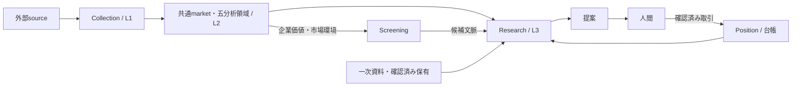

# Architecture

Baibai Loopは、外部から受領した事実を保存し、機械分析から調査の入口を作り、企業の経済的な価値と支払価格を比較する。AIは根拠付きの提案を作り、人間が採否・注文・約定を確認する。

## 情報の流れ

L1は原本またはsource契約で明示したprovider-native表現と受領事実、L2はその入力を選択・正規化・計算した情報、L3は仮定を伴う解釈・評価・判断である。型付き行は原本の代わりにならず、仮定を決定的な式で計算しても観測事実にはならない。五分析領域はL2の責務区分であり、領域ごとにL1/L2/L3の一式やDBを作らない。

## 責務と配置

engineのdomainは[`engine/src/baibai_engine/`](../engine/src/baibai_engine/)に置く。意味を持つ処理はそのdomainへ、業務を知らない技術は`storage`・`foundation`へ置く。

| 配置 | 所有する責務 |
| --- | --- |
| `collection/` | sourceとの通信、原本・native record・受領の契約 |
| `market/` | 保存された銘柄・財務・価格・公表日の共通読取と正規化、source固有の取得計画と取得・投影・保存の合成 |
| `screening/` | 企業価値・市場環境から候補を組立、価値仮説別の探索と候補文脈、歴史較正 |
| `research/` | 明示開始した有限調査、Stock Assessmentと独立Review、市場判断、Investment Proposal |
| `position/`・`tasks/` | 確認済み取引・保有・資本と運用上の進行状態 |
| `storage/`・`foundation/` | 接続、schema、transaction、lakeと汎用基盤 |

### L2の五モデル

正式名称は次の五つに統一する。括弧内の英語はコードとの対応であり、別モデルや別名を増やすものではない。企業価値のL2値は評価材料で、仮定を伴う最終的な企業価値判断はL3が行う。

| 正式名称・配置 | 観測・計算する材料 | L3で活用する問い |
| --- | --- | --- |
| [企業価値](reference/valuation-metrics.md)（Valuation）・`valuation/` | 財務比率、利益・資産に対する価格、機械ER/FVと[較正文脈](reference/estimate-calibration.md) | 事業・資本から株主へ帰属する価値に対し、何がどれだけ安いのか。正常収益・再投資・分配の仮定は価格に見合うか |
| [企業成長](reference/company-growth.md)（Company Growth）・`company_growth/` | 過去実績の水準と変化。会計四半期を軸に、単独期・年間/TTM・残高を区別 | 利益水準は拡大・回復・一時的上振れのどれか。採算・資本・CFの変化は価値仮定を支持するか。過去系列であって将来予測ではない |
| [市場環境](reference/market-context.md)（Market Context）・`market_context/` | 経済指標の水準・変化と、市場・業種・個別の相対状態 | 需要・費用・資金調達・要求収益へ何が伝わるか。個社固有の変化と共通環境をどう切り分けるか |
| [外部評価](reference/data-sources.md#external-assessment)（External Assessment）・`external_assessment/` | 外部の評価・予想と出所、対象期、更新時点、比較条件 | 自分の利益・価値仮定は外部とどこが違い、その差を何が説明するか。一致も独立した正解保証にはしない |
| [テクニカル分析](reference/technical-analysis.md)（Technical Analysis）・`technical_analysis/` | 保存価格の位置・勢い・変動幅。移動平均・BB・RSI | 価格はどの時間軸でどう反応しているか。事業仮説との不一致、購入条件や見直し時点へ何を示唆するか。価格から価値や将来を確定しない |

五モデルは独立した賛成票ではなく、同じ企業を別の切り口で見る材料である。企業成長から企業価値の利益仮定を点検し、市場環境からその変化の背景を考え、外部評価との差を調べ、テクニカル分析で価格の反応を読む。順序を固定せず、採否を変える不一致を起点に[五領域の統合](reference/stock-assessment.md#analysis-domain-integration)へ進む。

共通価格は、`market/price_reader.py`が原価格・action・coverage、`adjusted_prices.py`が分析用価格、`price_basis.py`が純粋な換算を所有する。価格調整と株数単位の変更は異なるため、同じ価格を扱う処理を一つの契約へ潰さない。

分析領域は必要な共通marketを使い、Research・Screening・UIへ逆依存しない。Researchは領域の公開読取入口から五領域と一次資料を統合する。Screeningは探索の入口を作り、企業価値や買付採否を確定しない。PositionはResearchへ逆依存せず、人間が確認した事実を保存する。

`web/`はbackend・frontend・edgeによる読取表示、`batch/`は定期処理と公開の合成、`tools/`は開発・保守用の入口である。Webは`read_api`、Batchは`batch_api`・`read_api`を通し、domainの算術・保存条件を複製しない。依存範囲の厳密な定義は[pyproject.toml](../pyproject.toml)にある。

意味・採否は本書・doctrine・各reference、開始・操作・完了/再開はskills・OPERATIONSが所有する。生成scaffoldは編集欄と短い注意・参照先を持ち、一回限りの計画・実験はIssueと固定commitへ残す。

## 判断と進行

ResearchのSelectionは対象・問い・入力を開始時に固定する。Stock Assessmentは企業の事業理解・価値・反証、Reviewはその内容の独立検証、Investment Proposalは価格・cash・保有へ適用した行動と条件である。Operation完了、提案公開、人間の採用、注文、約定を別の状態として扱う。

期間・観測日・公表日・受領cutoffを区別する。固定snapshotは再開時の入力を保つが、全入力のintraday point-in-time再現を保証しない。[入力の意味](reference/data-sources.md)と[判断の意味](reference/stock-assessment.md)が個別の制約を所有する。

| 作業の入口 | 操作先 |
| --- | --- |
| 新しい有限Research | [Researchの開始](../.agents/skills/research/SKILL.md#開始と固定対象) |
| 共通市場判断だけを作る | [市場環境判断（Market Context Assessment）](../.agents/skills/market-context-assessment/SKILL.md) |
| 人間が確認した取引事実を記す | [Ledger Record](../.agents/skills/ledger-record/SKILL.md) |
| 既存Operationを続ける | [保存入力からの再開](../.agents/skills/research/SKILL.md#完了と再開) |

3skillsは作業の開始条件で分けており、五分析領域と一対一にはしない。

## 保存責務

データ状態の正本はクラウドにあり、認可された作業環境とActionsが更新する。未公開の作業コピーと正本を区別し、世代を照合して反映する。

| 保存場所 | 役割 |
| --- | --- |
| application DB | 判断・Review・提案・Selection・Operation・task・台帳の正本と作業コピー |
| market lake | L1原本とL2投影のimmutable object・manifest。readerは一つのreleaseを固定する |
| market SQLite | lake対象tableの実行用コピーと、取得coverage等のstore-local情報 |
| economic source SQLite | 経済原本・受領・取得記録。Readingは保存原本とmethodから読取時に計算する |
| screening runs / calibration | 再生成可能な探索結果と較正snapshot |
| serving JSON | 表示用の派生物。保存判断・台帳の第二正本にしない |

source取得は担当範囲の再生成可能なread-only inputと原受領handoffだけを扱う。共通統合は開始時に存在するimmutable受領を固定し、取得全体の完了を待たず、最新正本へ各domainのprojection/rebuildを適用して一回のfull lake公開・L2・表示を行う。source-local SQLiteは全体releaseへboundな実行コピーではなく、full originを持たせない。経済の一時受領は実取得の同値も保持し、正本への変更時追記・同値no-opは最新正本との比較で決める。

クラウド正本のapplication objectは`baibai-stores/baibai.sqlite`。ローカルpathは[repository_layout.py](../engine/src/baibai_engine/foundation/repository_layout.py)が所有する。market全体を消してstore-local情報を失わず、空のhydrateから取得成功記録を創作しない。

採用済みのdated規則は[`screening/rules/`](../engine/src/baibai_engine/screening/rules/)と[`market_context/reading/rules/`](../engine/src/baibai_engine/market_context/reading/rules/)へ配置し、既定revisionは各loaderが読む。規則の意味を変える場合は新revisionとし、配置変更だけで内容・識別子・保存判断を変えない。較正の配布artifactは[`valuation/calibration/published/`](../engine/src/baibai_engine/valuation/calibration/published/)、テスト入力は[`tests/fixtures/`](../tests/fixtures/)、表示設定は`web/config/`に置く。[reports](../reports/README.md)には運用責務の確認・移管が残る記録だけを保持し、完了した実験の詳細は固定commitへ委ねる。再取得可能であることは改訂前の情報を復元できることを意味せず、汎用DB・registryや保存判断の第二正本は作らない。

運用上の取得・発行・復旧は[OPERATIONS](../batch/OPERATIONS.md)、設計判断は[doctrine](doctrine.md)、開発環境は[development](development.md)に従う。
