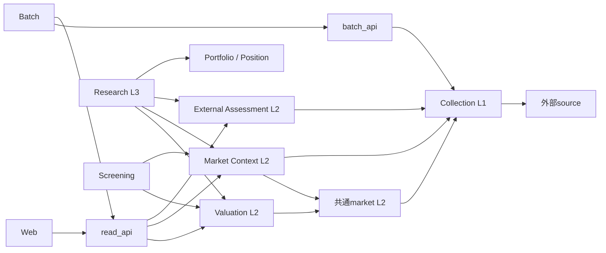

# Architecture

Baibai Loopの目的は、割安銘柄を発見し、割安幅と条件付き収益を評価し、根拠を伴う一銘柄ずつの売買提案へつなげることである。実売買、提案の採用、注文・約定の確認は人間が行う。

この文書は設計上の境界・依存・保存責務を所有する。用語と成果物の関係は[domain-language](./domain-language.md)、実契約は[reference](./reference/README.md)、操作は[各skill](../.agents/skills/)と[batch運用](../batch/OPERATIONS.md)が所有する。Issueは意思決定と移行の証拠であり、現行仕様をコメントだけに置かない。以下に責務と現行境界を示す。

<a id="information-layers"></a>

## 1. 情報層と分析領域

設計の主軸は情報の生成責務である。L1 Collectionが外部の元データを保持し、L2がその入力を機械的に処理し、L3が結果を統合・解釈して判断や提案を作る。Valuation・Market Context・External Assessmentは主にL2の分析結果を整理する区分であり、各々が独立したL1/L2/L3一式を持つ縦割りsubsystemではない。[三分析領域](./domain-language.md#analysis-domains)と層を区別し、具体的な所有は[下表](#repository-map)に示す。

中心ユースケースは、保存入力から決定的な日次機会発見を行うScreeningと、候補・分析結果・一次資料を使う有限Researchである。注文・約定・入出金など人間が確認するbroker factとPortfolio/Positionは分析層とは別の業務である。

| 層 | 内容 |
| --- | --- |
| L1 Collection | 外部から受領した原本、またはsource契約に明示したprovider-native表現と、出所・要求・実受領時点。取得・保持は分析用途から独立する |
| L2 機械分析 | 保存L1と明示した規則から再現する解析・正規化・選択・計算・集計・比較。共通のmarket読取modelも含む |
| L3 解釈・判断 | L2や根拠資料を統合し、仮定・評価・判断・提案を作る。ResearchがStock Assessment、Market Context Assessment、Investment Proposalを所有する |

型付き・抽出済み、または日付や銘柄を正規化したmodelは、それだけで原本にはならない。AIが置く仮定を決定的算術で計算しても仮定はL1にならず、条件付き判断成果物と機械的なL2を区別する。層数に合わせてDB・package・serviceを増やさない。

L1の保存構造は、source契約に従って原本・provider-native fieldと欠測を可能な限り残す。現在の計算が使わないという理由だけで値を捨てず、取得量・保存量・利用条件と用途を合わせて判断する。HTTP body bytes、SDKのtool-result、CSV等から組み立てたnative recordは異なる入力であり、後者を原HTTP応答とは呼ばない。SDKが破棄した未知field、取得前の改定履歴、原本を失った旧加工済み行やZIP cacheから、架空の原本を補完しない。

取引カレンダーは提供元の休日区分（HolDiv）を保持し、現物株の営業日判定は読取時に区分1・2から導く。区分0（非営業日）と3（祝日取引あり）、区分1（営業日）と2（半日立会日）を保存時に潰さない。旧booleanから原区分は復元せず、切替時に原本から再構築する。

期間集計、株式単位の換算、予想の選択、欠測の扱い、倍率・比較・見積りはL2の責務とし、加工済みの値だけをL1の正本にしない。検索や計算効率のための展開列・materializationは元入力から再生成できる副次構造とし、独立した二つの正本を作らない。既存schemaの維持や互換処理の追加より、現行ドメインに必要な保存構造への見直しを優先する。保管対象と期間は業務・再計算に必要な範囲とし、全要求の監査や一律の永久保存を目的にしない。

判断用入力は値に加え、出所、対象・観測・取得・公開の時点、欠測と比較上の制約を持つ。外部アナリストの判断も「外部がそう提示した」受領資料としてL1に保持し、その機械的抽出・整理はL2、自分たちの解釈はL3とする。転載を独立票と数えず、異種のrating・目標株価・Quants scoreを単一投票に潰さない。独自の総合scoreや自動注文を追加しない。

<a id="layers"></a>

## 2. 最終依存境界



矢印は入力・読取の依存を示す。Collectionは分析領域やResearchに依存せず、共通market L2と各分析領域は保存入力を読む。三領域は相互やResearch・Screening・UIへ逆依存しない。Researchは領域の公開読取入口を呼び、UI向け`read_api`を内部業務入力にしない。ScreeningはValuationとMarket Contextの結果を組み立て、候補探索・候補一覧を所有する。External AssessmentはResearchと公開読取の参考入力であり、候補一覧の推薦・順序には使わない。

Webのengine入口は`read_api`、Batchは`batch_api`/`read_api`である。Batchは判断や書込条件を複製せず、既存serviceへ委譲する。Collectionがsource別の取得・原本契約を、L2が変換と計算を所有し、物理保存には共有`storage`を使う。共有storageは純粋契約と技術helperだけを参照し、分析・AI・UI・取得serviceへ依存しない。純粋な型・算術は保存や取得を読み込まない。

Portfolio/Positionは確認済み取引と保有を所有し、Researchへ逆依存しない。確認済みbroker factを扱うCLIの合成入口は保存済み判断の参照解決を渡し、Positionのdraft組立・事実記録へ委譲する。参照解決と取引事実の記録を別の責務として保つ。Operation/taskは進行状態であり、投資評価や取引事実を代行しない。

実装は単一distributionの`baibai_engine`、表示を担う`baibai_web`、運用を担う`baibai_batch`で構成する。依存制約の厳密な範囲と公開CLIの合成例外は[import-linter設定](../pyproject.toml)が検査する。

<a id="repository-map"></a>

## 3. モデル・入力・出力の所有

以下は意味の所有と公開境界の対応である。保存場所は領域数に合わせず、field・SQL・計算式はリンク先の実契約へ委譲する。

| 所有 | 主モデル・成果物 | 入力と出力 | 保存・公開入口 |
| --- | --- | --- | --- |
| Collection / L1 | provider別の原本・native record・受領receipt | `collection/{economic,jquants,edinet,jpx,tradingview,equity_web}`がsource契約・取得・保持を所有する。L2系列や投資判断を選ばない | market SQLite/Lakeと経済SQLiteの原本。各source契約は[入力](./reference/data-sources.md)・[market lake](./reference/market-lake.md)・[経済source catalog](../engine/src/baibai_engine/collection/economic/sources.yaml) |
| 共通market / L2 | 価格・銘柄・財務等の型付き読取modelと選択済みprojection | `market`が保存原本から共通の正規化・decode・読取modelを作る。型付き行はL1原本そのものではない | market SQLite/Lakeの`l2_processed` datasetと読取入口。[market lake](./reference/market-lake.md) |
| Valuation / L2 | FinancialSnapshot、倍率/機械ER/FV、ER較正文脈 | `valuation/metrics`が保存L1と共通market L2から財務/TTM/倍率・自己レンジを計算する。企業固有の仮定による`valuation/scenario`はResearchの条件付き評価に使う | Stock Analysisと領域読取、`read_api/valuation`・`read_api/er_calibration_context`。[Valuation](./reference/valuation-metrics.md#machine-valuation) |
| Market Context / L2 | Market Snapshot、Security Market Context、Reading | `market_context/{history,prices,margin,sector,snapshot,security}`が市場・個別相対、`indicators`がL2系列定義、`reading`が経済原本の選択・計算・統計を所有する | `reading/query`と`read_api/market_context`。経済SQLiteにはL2系列を保存しない。[Market Context](./reference/market-context.md#market-context-reads) |
| External Assessment / L2 | 提示値の抽出、出所別比較・欠測 | `external_assessment/acquisition`がbounded取得をraw captureとnormalizationへつなぎ、`normalization`・`analysis`が抽出・比較する。HTTP/MCP transportと原本契約はCollectionに置く | 解析済み観測はmarket SQLite/LakeのL2、`external_assessment/query`・`read_api/external_assessment`から読む。[入力](./reference/data-sources.md#external-assessment) |
| Screening | Stock Analysis、CandidateReason、候補文脈と候補一覧 | `screening/metrics/snapshot`がL2結果を組み立て、`discovery`が同runの候補文脈を確定し、`calibration`が較正を行う | runs storeとcalibration snapshot。`screening`の公開入口と`batch_api`。[Screening](./reference/screening-runtime.md) |
| Research / L3 | Research selection、MarketContextAssessment、Stock Assessment/Review、Investment Proposal | 保存済み分析結果・出典・保有を統合し、一銘柄ずつ解釈・仮定・判断・提案を作る。transportには依存しない | applicationの判断履歴。[Research](../.agents/skills/research/SKILL.md) |
| Portfolio/Position | Ledger、Reservation、Holding、Outcome | 人間確認済みbroker factを記録し、保有と資本を再構築する。分析層とは別の業務 | application。Positionの事実記録・読取service。[Portfolio](./portfolio-management.md) |
| Operation/task | Operation Session、調査進行、運用task | 明示開始・対象・成果・完了/未完了を記録する。AI完了を採用・約定に変換しない | application。`research/operation`と`tasks`のservice |

Collection内の名前付き取得元は、経済統計（provider-native record・文書body）、J-Quants（native HTTP JSON page）、EDINET（一覧応答・CSV/XBRL ZIP bytes）、JPX（HTTP body・workbook等）、TradingView（SDK `CallToolResult`）、公開株式Web（HTML body bytes）である。保持する範囲・identityは各[入力契約](./reference/data-sources.md)と[market lake契約](./reference/market-lake.md)に従う。provider familyのfolderはコードの整理単位であり、familyごとの物理DBや全source共通のruntime registryではない。新しい外部参考評価元は名前付き取得・原本契約と対応するL2 normalizationを拡張し、全sourceを一つの人工schemaに押し込まない。BB20は保存済み価格から読取時に作る[共有の個別価格context](./reference/market-context.md#market-context-reads)のL2計算として実装済みであり、新しいsource・storeや経済Reading registry項目は持たない。RSIは未実装・未採用の将来案であり、追加の採否は別途検討する。

L1の定期取得とL2の定期・読取時処理を、L3の明示開始と区別する。一つのOperationは新規または保有の単一scopeとし、保存capacityに従って開始時に対象を固定する。0件・部分完了・未完了も記録し、弱い候補で枠を埋めず、一銘柄ずつ提案する。AIの完了、人間の採用、注文、約定は別の事実・状態である。成果物間の関係は[Decision flow](./domain-language.md#decision-flow)、開始・発行の条件は各skillが所有する。

<a id="store-authority"></a>

## 4. 保存責務と正本

storageは物理保存の技術責務であり、保存DBをL3そのものと呼ばない。application DBには判断と周辺業務の両方が入り、再生成可能なL2も用途に応じて異なる保存場所を使う。runtimeの物理SQLiteはapplication・market・経済source・screening runs・calibrationの五系統であり、層やsource familyに合わせて数を変えない。Readingは保存経済原本とdated規則からread-timeに計算し、独立DBを新設しない。

| 保存場所 | 正本・作業コピーの関係 | 意味/書込条件のowner |
| --- | --- | --- |
| R2 `baibai-stores/baibai.sqlite` / `stores/application/baibai.sqlite` | クラウド正本と判断・ledger・task・Operation等の作業コピー | 各application domain service |
| R2 `lake/` | `l1_source`と`l2_processed`の不変object・manifest・current pointer | Collectionと各L2 ownerのdataset契約、既存`publish-lake` |
| `stores/market/market.sqlite` | lake所有tableのruntime copy。`source_coverage`等のstore-local dataはR2 market store、`lake_store_origin`はコピーの由来 | source domain/SQL adapter。接続・schema・hydrateは共有storage |
| `stores/screening/runs.sqlite` | 再生成可能なScreening Run・候補一覧 | Screening |
| `stores/screening/calibration/current.sqlite` | 再生成可能なcalibration snapshot | Calibration |
| `stores/market_context/indicators.sqlite` | 経済sourceのnative record・文書・取得runの作業コピー。L2系列・計算値は保存しない | `collection/economic`の原本契約・DB adapter |

データ状態の正本はクラウド、承認済み作業環境/Actionsは更新元である。未公開変更を正本と区別し、取得世代を保持して競合上書きを止める。コピーの取得時点と反映状態を区別し、market storeを丸ごと消してstore-local dataを失わない。serving JSONは表示用派生物であり、application DBの本文や完了履歴の代替ではない。再取得できることは改定前情報の再現を保証しない。再生成可能なL2へ一律に永久保存を要求しない。

共有技術保存は`storage/application`・`storage/observations`・`storage/lake`に配置する。source別の取得・原本意味はCollection、共通の正規化・読取modelはmarket等のL2に置き、物理保存のownerと意味のownerを混同しない。保存・保持は[market lake](./reference/market-lake.md)、転送・復旧は[batch運用](../batch/OPERATIONS.md)を参照する。

<a id="edinet-metric-revision"></a>

EDINETのCSV/XBRL ZIP bytesは既存SQLite `edinet_source_archives`を取得・再利用の入力として保持し、`edinet.source_archives`としてLakeへ公開する。list responseの受領もL1、そこから選択・抽出したdocument、metric、segment、debtはL2であり、原本の空欄・単位・contextや未選択項目を置き換えない。旧加工済み行や端末ZIP cacheを暗黙の原本として取り込まず、原本がない既存抽出履歴は復元したと主張せず保持する。独立した監査DBや全要求履歴は追加しない。

EDINET metricのrevisionは抽出意味の変更時だけ明示更新し、配置・import・transport retryでは更新しない。対象とprovenanceは[データソース](./reference/data-sources.md#edinet-metric-revision)、[反映手順](../batch/OPERATIONS.md#edinet-metrics-revision)はbatch運用が所有する。

<a id="migration-status"></a>

## 5. 現行writerと保存履歴

現行配置は[所有表](#repository-map)に集約する。Market ContextのCLIは`market-context indicators / reading`で機械読取へ渡し、市場判断のCLIは`research market-context`でResearchへ渡す。Webは両者の読取結果を表示用に組み合わせる。新規writerと保存済み判断の読取は区別し、旧payloadを新規判断として再発行しない。schema・参照field・履歴読取の詳細は[Market Context reference](./reference/market-context.md#現行配置と保全するidentity)、外部評価の永続名は[保存済み照会](./reference/market-lake.md#external-assessment-query)が所有する。

Readingの現行選択先は`READING_RULES_PATH`が指す`method/macro/reading/2026-08-01T100000+0900.yaml`である。保存判断が引用する数値・fieldの意味・dated pathを保持し、名前切替のための移設・複製・revision変更を行わない。計算を変えない説明訂正は可能とし、変更前のbytesはgit履歴で確認する。

実装・移行と通常運用の受入は区別する。完了した層・配置整理と本番切替の確認証拠は[Issue #1543](https://github.com/koumatsumoto/baibai-loop/issues/1543)に残し、現行仕様は本書とreference、後続の変更は対応するIssueで管理する。

<a id="cloud-serving-layer"></a>

## 6. 実行環境と公開入口

Ubuntu Linux/POSIXを対象とし、作業分担は[Python foundation](./reference/python-foundation.md#cloud-development-boundary)に従う。SQLite編集は作業コピー上で行い、検証済み変更をクラウドへ反映する。

```text
承認済み作業環境 ──条件付き更新──> R2 stores（データ状態の正本）
GitHub Actions ──定期処理・転送──> R2 stores
GitHub Actions ──read model生成──> R2 serving ──> Worker ──> browser
```

`baibai-engine`はdomain操作、`baibai-web`は表示/read model、`baibai-batch`は運用の入口である。optionの正本はpublic `--help`。[docs portal](./README.md#目的別の入口)から実操作へ進む。

<a id="failure-policy"></a>

## 7. 停止条件と変更の検証

必須入力が得られない時や、壊れたstore/release/viewを次の利用者へ渡す時は止める。optionalな欠測・古さで無関係な出力まで止めず、対象値の未評価と理由を示す。正常な未作成と既存保存物の破損を区別し、個別隔離で必須集合やledgerを勝手に欠落させない。schema・coverage・世代/CAS・履歴保護を維持する。終了状態と公開/通知の成否は[batch運用](../batch/OPERATIONS.md)が所有する。

<a id="four-roles"></a>
<a id="naming-and-history"></a>

変更では配置・保存・画面・CLI・docsを同じ責務へ揃え、無価値な互換層・重複・汎用化を削る。内部の旧名・aliasは原則残さず、caller・model・serializer・CLI・test・active docsを同じ変更で揃える。provider-native fieldと保存済み判断のidentity・引用・実取引事実は内部命名と区別し、命名整理で書き換えない。単なる配置変更では意味不変を確認する。一方、設計を改善するためのschema変更では過去の構造・履歴の維持を必須にせず、必要なデータ移行・再構築・リセットを選ぶ。保持対象と失われる範囲を区別し、過去の制約のためだけの互換層を追加しない。成果を産む・誤りを止める・測る・見せる役割は識別するが、定型的な枠や新機構を増やす目的にしない。採否は[開発原則](./doctrine.md#development-investment-policy)、field/type/書込条件はmodel・DB constraint・domain service、完全gateは[Python foundation](./reference/python-foundation.md#9-ci-and-local-parity)に従う。
