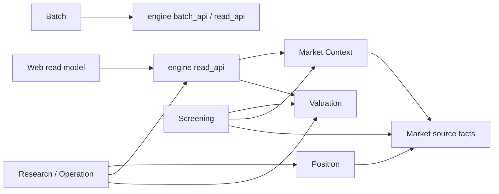

# Architecture

Baibai Loopは単一distribution内で、domainを所有する`baibai_engine`、読み取り専用の表示を担う`baibai_web`、定期処理と転送を担う`baibai_batch`を分ける。開発・実行環境はUbuntu Linuxを対象とし、POSIX pathとGNU/Linuxのfilesystemを前提にする。

<a id="layers"></a>

## 1. Packageの依存



図は主要な責務間の依存を示す。CLIで複数domainを合成する例外の範囲はimport-linter設定が所有する。

engineはweb・batch・toolsへ依存しない。Webからengineへの入口は`read_api`、batchからは`batch_api`と`read_api`であり、import-linterが境界を検査する。batchはdomainの判断やwrite invariantを独自実装せず、engineのserviceへ委譲する。storeとserving objectの転送はbatchが担う。

公開brokerの取得・保存・読取・同一系列比較は`market/retail_dynamics`が所有する。schema/lakeはI/Oを持たないleaf contractだけを参照し、Web・toolsは専用read facadeを使う。Research、FV、Screening順位、配分・発注判断へ観測serviceを依存させない。入力の意味は[data sources](./reference/data-sources.md#retail-dynamics)を参照する。

<a id="four-roles"></a>

機構の役割は、業務の成果を「産む」、誤った出力を「止める」、結果を「測る」、判断材料を「見せる」で説明する。採否は[開発原則](./doctrine.md#development-investment-policy)に従う。この分類を全moduleに定型文として記載する義務は設けない。

## 2. 業務と人間gate

成果物と人間判断の関係は[Decision flow](./domain-language.md#decision-flow)、実行する操作は[目的別入口](./README.md#目的別の入口)から該当skillを参照する。

<a id="information-layers"></a>

## 3. 情報の正本と保持

| 区分 | 内容 |
| --- | --- |
| L1 fact | sourceから取得した観測 |
| L2 machine | 保存入力とmethodから導出する機械出力 |
| L3 AI interpretation | 調査・解釈・条件付き評価・提案 |
| 周辺業務 | 確認済み取引事実、task・Operation等の記録と進行状態 |
| method / config | Git管理の計算規則、調査手法、表示設定 |

application DBはL3判断と周辺業務の両方を保存する。保存先を分析層と同一視しない。人間の最終採否・証券注文・約定確認は外部アクターの責務であり、確認済み事実の記録はシステム内の周辺業務である。また、現在のsourceから再取得できることは、過去の改定前状態の再現を意味しない。再生成可能なL2に新たな永久保存を要求せず、復旧元と保持範囲は各storeの契約に従う。観測・導出・見積り・判断の区別は[doctrine](./doctrine.md#fact-analysis-separation)が所有する。

### Store authority

| 保存場所 | 正本として所有する情報 | write owner |
| --- | --- | --- |
| `stores/application/baibai.sqlite` | 判断、ledger、task、Operation、outcomeの作業コピー。正本はR2 `baibai-stores/baibai.sqlite` | engine application service |
| R2 `lake/` | lake所有datasetのimmutable object、manifest、current pointer | `publish-lake` |
| `stores/market/market.sqlite` | lake所有tableはruntime copy。`source_coverage`と`tse_capital_policy_snapshots`はlakeでなくR2のmarket storeが保持し、`lake_store_origin`はコピーの由来metadata | market provider・lake hydrate |
| `stores/screening/runs.sqlite` | 再生成可能なScreening Run・Review Set | screening service |
| `stores/screening/calibration/current.sqlite` | 再生成可能なcalibration snapshot | calibration service |
| `stores/macro/macro.sqlite` | macro観測・vintage・取得情報。manual観測はGit seedから同期 | macro indicator service |

market storeをファイルごと消すとstore-local dataも失うため、lake所有tableが再生成可能という理由だけで削除しない。データ状態の正本はクラウドに置き、PCとGitHub Actionsは取得した作業コピーから更新する。未公開の変更は正本と区別し、取得世代を保持して競合時の上書きを止める。application DBやmachine storeを読むときは、コピーの取得時点とクラウドへの反映状態を区別する。serving JSONは表示用の派生物であり、task本文や完了履歴を含むapplication DBの代替ではない。

lakeの公開・hydrate・保持は[market lake](./reference/market-lake.md)、storeの転送・移行・復旧は[batch運用](../batch/OPERATIONS.md)が所有する。methodと表示configの入口は[method](../method/README.md)と[web/config](../web/config)を参照する。

<a id="cloud-serving-layer"></a>

## 4. 実行環境

PCでの全操作とGitHub Actionsでの更新は、クラウド正本という保存場所の方針と両立する。SQLiteへの編集は作業コピー上で行い、検証済みの変更をクラウドへ反映する。
ChatGPTクラウド開発環境を含む作業分担は[Python foundation](./reference/python-foundation.md#cloud-development-boundary)に従う。

```text
PCの作業コピー ──条件付き更新──> R2 stores（データ状態の正本）
                                      ↑
GitHub Actions ──machine処理・転送──────┤
       └──read model生成──> R2 serving ──> Worker ──> browser
```

Owner MCPは所有者が保存済み情報を読むlocal adapterであり、store更新や定期batchを起動しない。toolと接続の契約は[Owner MCP](../tools/owner_mcp/README.md)を参照する。

<a id="repository-map"></a>

## 5. 機構と責務

| 配置・module | 責務 |
| --- | --- |
| `engine/src/baibai_engine/market` | source factの取得・保存・公表日判断、固定release読取、market store |
| `engine/src/baibai_engine/macro` | 経済系列の取得・保存、既存Reading計算kernel、Macro Contextの型・発行・scorecard |
| `engine/src/baibai_engine/market_context` | 市場snapshot、benchmark方向、業種平均対市場平均、個別対市場/同業、cutoff付きL1読取、保存済みReading/Context読取 |
| `engine/src/baibai_engine/screening` | 必要入力のpreflight、Security Analysis、Candidate Discovery、Triage、calibration |
| `engine/src/baibai_engine/valuation` | 小さな入力からのER/FV機械推計、評価前提型、Projection、条件付き収益の純粋算術、保存済み推計の投影 |
| `engine/src/baibai_engine/research` | 統合Thesis、調査進行、独立Review・発行・store、CAA、Planning、Position Review |
| `engine/src/baibai_engine/position` | 確認済み取引事実、ledger replay、保有と資本の評価、outcome |
| `engine/src/baibai_engine/research/operation` | Research SetとCAAに束縛したOperation Session |
| `engine/src/baibai_engine/tasks` | 運用task |
| `engine/src/baibai_engine/appdb` | application DB |
| `engine/src/baibai_engine/read_api` | engineの読み取りuse case |
| `web/` | read model、local UI、frontend、Worker、Web contract |
| `batch/` | 定期処理、local Triage runner、転送、通知 |
| `tools/` | 品質検査、実験、診断、所有者用adapter |
| `method/` | 採用した計算規則と調査playbook |
| `stores/` | 実行時store |
| `reports/` | historical evidenceと明示的なconsumer artifact |

Valuationの型・算術・機械推計は`valuation`に集約済み。Screeningのbuilderが必要入力だけを変換し、Security Analysisへの保存、4 Approachの候補探索とcalibrationは現在の`screening`配置に残る。Market Contextの市場・業種・個別相対計算と保存済みmacro読取は`market_context`へ集約した。macro観測の保存identity、既存Reading計算kernelとContextの発行経路は`macro`に残る。External Assessmentは未移行で、現行`market/retail_dynamics`・`market/tradingview`を使う。三領域を三サービス・三DB・9パッケージへ分割しない。

ValuationはResearch・read_api・Screeningへ依存しない。保存済み解析の読取use caseは`read_api/valuation`がrun-store readerとValuationの小さな投影を組み合わせる。領域内部からResearchをeager importする`read_api/__init__.py`を呼ばない。Thesis全体や評価時点の価格factを扱う合成はResearchが所有する。保存済み評価の対象・cutoff・欠測は[Valuation metrics](./reference/valuation-metrics.md#machine-valuation)に従う。

Market ContextはL1 reader、macroの型・既存Reading計算と自領域の算術へ依存し、Research・CAA・Screening・Position・UI合成read_apiへ依存しない。SQLiteの汎用read-only/未作成判定は`foundation/sqlite_read`、application schema検証は`appdb/read`が所有する。領域読取は取得・書込を行わない。Webの`read_api/market_context`、既存CLI、batch/Triage callerが同じ領域読取へ委譲する。Macro Context packageの起動でwriterをeager importせず、発行は明示serviceだけを使う。

現在もdailyのscreening失敗とmacro公開は独立していない。workflow/store/部分公開の分離と、AI調査・提案への新しい接続は未完了である。

変更箇所は次の順に辿る。

| 変更したいもの | 実装と検証の入口 |
| --- | --- |
| sourceの取得・保存 | `market/providers`、`market/sqlite`、`market/edinet_metrics`とsource別test |
| 機械ER/FV・条件付き収益算術 | `valuation/{estimates,models,scenario,query}`、`read_api/valuation`とvaluation test |
| 指標と候補選抜 | `screening/metrics`、`screening/discovery`、`tests/engine/screening` |
| 較正 | `screening/calibration/evaluation`とcalibration test |
| Researchの開始・下書き・発行 | `research/workspace/{admission,prepare,scaffold,status,validation,publication}`とworkspace test |
| 調査sessionの完了 | `research/operation`とOperation test |
| 市場・業種・個別相対の計算と読取 | `market_context/{snapshot,benchmark,sector,security,prices,master,macro}`、`read_api/market_context`とMarket Context test |
| 銘柄profile | `read_api/ticker_profile`は領域出力・event・保存済みSecurity Analysis・portfolioを合成する。portfolioの独立基準日は[Market Context読取](./reference/macro.md#market-context-reads)を参照 |
| dashboard・企業画面 | `web/backend/src/baibai_web/readmodel/{builders,stocks}` → model → 生成contract → frontendと`tests/web` |

業務の責務、情報の正本、実行環境は別の軸である。上表は現在の配置を示し、L1/L2/L3をそのままpackage階層にはしない。依存制約の厳密な範囲は[import-linter設定](../pyproject.toml)、入力の取得・計算の変更は[Screening reference](./reference/screening-runtime.md#market-store-inputs)から辿る。

### CLI

`baibai-engine`はdomainの読取・書込、`baibai-web`は表示・read model、`baibai-batch`はrepository内の運用処理の入口である。command・option・required・defaultはpublic `--help`を参照する。

### 投資判断と取引事実の依存

researchが企業評価と資本判断を所有し、core positionはresearchをimportしない。researchのbroker fact処理は保存済み判断のidentityを解決し、positionの事実記録へ渡す。

資本の現在値と未評価は`position/valuation.py`、quoteと権利basisの読取は`position/market_source.py`、ledgerの再構築は`position/ledger_read.py`に集約する。Planning、Position Review、read APIはこれらを使い、同じ算術・SQL・保存値検証を再実装しない。

<a id="failure-policy"></a>

## 6. Failure policy

無人経路が停止するのは、必須入力を得られない場合、または続行すると壊れたstore・release・viewを次の利用者へ渡す場合である。optionalな観測の不足・古さだけで無関係な出力まで止めず、対象値の未評価と理由を示す。

正常な未作成と保存物の破損を区別する。public readerの未作成file・tableを持たないunwritten storeは空viewとし、既存schemaの不一致やcurrent schemaのtable欠損は拒否する。書込可否を判断するreaderは必要なstoreの不在も拒否する。個別recordの隔離は出力契約を保てる場合に限り、必須の集合やledgerを勝手に欠落させない。

producerの計算identity変更は再生成の契機であり、それ自体を障害としない。入力世代の競合、履歴の後退、壊れた出力を防ぐ既存のschema・coverage・CAS等は維持する。batchの終了状態と公開・通知の成否は[batch運用](../batch/OPERATIONS.md)で扱う。

## 7. Development gates

型・保存・書込の条件はdomain model、DB constraint、serviceと対応testが所有する。検証層の使い分けと完全local gateは[Python foundation](./reference/python-foundation.md)を参照する。
