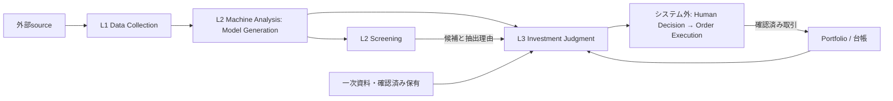

# Architecture

Baibai Loopは、外部から受領した事実を保存し、機械分析から調査の入口を作り、企業の経済的な価値と支払価格を比較する。AIは根拠付きの提案を作り、人間が採否・注文・約定を確認する。

採用名称と意味の区別は[用語集](glossary.md)。以下の配置表は現行実装を示し、Company Financials・Portfolioの名称と旧module名の不一致は#1632で解消する。保存identityは名称変更だけで書き換えない。

## 情報の流れ

L1 **情報収集 / Data Collection**は原本またはsource契約で明示したprovider-native表現と受領事実を保持する。L2 **機械分析 / Machine Analysis**は入力を選択・正規化・計算する**モデル生成 / Model Generation**と、規則に従う**候補抽出 / Screening**である。同じ入力・規則・計算実装・基準時点なら同じ結果を返す。L3 **投資判断 / Investment Judgment**は仮定を伴う解釈・評価・判断である。型付き行は原本の代わりにならず、仮定を決定的な式で計算してもL2の観測にはならない。

L1〜L3は情報の性質、ジョブ・エンジン・AI・人間は実行主体の区分である。情報取得ジョブはsource別に独立して実行・再実行し、担当範囲の取得ロジックをData Collectionへ委ねる。共通統合ジョブは全取得の完了を待たず、開始時に利用可能な受領と適格な保存入力からモデル生成と候補抽出を起動する。必要時も同じエンジンを使い、遅延と欠測を区別する。

## 責務と配置

engineのdomainは[`engine/src/baibai_engine/`](../engine/src/baibai_engine/)に置く。意味を持つ処理はそのdomainへ、業務を知らない技術は`storage`・`foundation`へ置く。

| 配置 | 所有する責務 |
| --- | --- |
| `data_collection/` | 情報収集 / Data Collection：sourceとの通信、原本・native record・受領の契約、取得の合成 |
| `machine_analysis/company_valuation/` | 企業財務 / Company Financials：[現行の財務観測・利益と価格の座標](reference/company-valuation.md)、旧runの機械ER/FVと[較正文脈](reference/estimate-calibration.md) |
| `machine_analysis/company_growth/` | 企業成長 / Company Growth：[過去実績状態・変化](reference/company-growth.md)、会計四半期を整理軸とする振り返り |
| `machine_analysis/market_context/` | 市場環境 / Market Context：[経済Reading、市場・業種・個別の相対状態](reference/market-context.md) |
| `machine_analysis/external_assessment/` | 外部評価 / External Assessment：[外部提示値の出所・対象期・比較条件と欠測](reference/data-sources.md#external-assessment) |
| `machine_analysis/technical_analysis/` | テクニカル分析 / Technical Analysis：[保存価格の位置・勢い・変動幅](reference/technical-analysis.md) |
| `machine_analysis/screening/` | 候補抽出 / Screening：保存済みモデルから規則に基づく候補と抽出理由を作り、政策・対象母集団・結果を保存。旧runの読取と較正保守は別経路 |
| `investment_judgment/` | Company Research・Stock Assessment・Independent Review・Trade Proposal、市場判断、Selection/Operationの進行、仮定付き評価算術 |
| `market/` | 共通観測の読取・正規化・価格/財務算術と、source取得・handoff・投影の既存合成 |
| `position/`・`tasks/` | 確認済み取引・保有・資本と運用上の進行状態 |
| `storage/`・`foundation/` | 接続、schema、transaction、lakeと汎用基盤 |

現在のモデル数は五つだが、責務分離は五つに固定するための設計ではない。追加の観測を候補抽出へ活かす設計は[別企画 #1633](https://github.com/koumatsumoto/baibai-loop/issues/1633)で扱い、現行二viewが全モデルを使うとは説明しない。

五モデルはScreening専用の中間データではない。Investment Judgmentは保存モデルと一次資料を統合し、候補外の企業も調査できる。現行のCompany Financialsは財務観測と利益・価格の座標を渡し、機械ER/FVは新Selectionの入力に含めない。同domainに残る機械ER/FVと較正は旧runの読取・保守用である。企業価値の評価はL3、最終買付採否は人間が担い、Screeningはどちらも確定しない。

統合判断の採否基準は[doctrine](doctrine.md#fact-analysis-separation)、五モデルを企業仮定へ接続する方法は[銘柄評価](reference/stock-assessment.md#analysis-domain-integration)が所有する。

共通モデル生成は、固定market releaseと独立economic snapshotから各domainの計算を合成し、候補抽出より先に全対象の結果を一つの世代として保存する。途中失敗した世代は公開しない。この順序により、候補政策を変えても元の観測を失わず、候補外の調査も同じ入力に基づける。Screeningは現在、保存済みのCompany FinancialsとTechnical Analysisから[二つのview](reference/screening-runtime.md#rule-purpose)を作る。Jobsは生成・抽出・同じreleaseの公開順を所有する。

投資判断を始めるSelectionは、必要なモデル断面と候補抽出の政策・結果・公開時刻をapplication DBへ複写し、再開時に再計算しない。新規Operationはこの生成済み入力だけを受け付け、旧runと可変storeからの新規収集経路は持たない。保存済み旧Selectionは元のhash・入力を保ち、Operation IDから再開する。算式・field・分岐は実装、結果を解釈するうえで必要な経済的意味は各referenceが所有する。

現在の`market/`は共通観測の読取・正規化・価格/財務算術に加え、source取得・原受領handoff・最新正本への投影を合成し、L1/L2をまたぐ。source通信と受領はData Collection、通信のない観測と計算はMachine Analysisへ分けるのが目標だが、TradingViewの保存原本からのrebuild等には既存の合成境界が残る。原本を保存したことと、正しいL2へ投影できたことを一つの成功状態にしない。

仮定付きProjection・return/Pmax・CB算術は`investment_judgment/`が所有する。Portfolioも使う汎用数値変換を共通基盤へ分け、PortfolioからL3への逆依存を作らない。モデルは判断・候補選択・UIへ逆依存せず、Portfolioは人間の確認済み事実を保存する。

`jobs/`は情報取得・共通統合の実行の合成、`tools/`は開発・保守用の入口である。Jobsは各責務の公開入口を直接合成し、domainの算術・保存条件を複製しない。集約した再export facadeを依存境界の代わりにしない。Webは資産・損益・保有銘柄、運用成績、タスクだけを保持する。旧調査提案・候補一覧・マクロ一覧・前回差分と外部データ取得APIは撤去し、コアの成功条件に含めない。Webは所有domainの読取を合成し、旧screening互換に依存しない。最新売買提案レポートの再設計はIssue #1615で扱う。依存範囲の厳密な定義は[pyproject.toml](../pyproject.toml)にある。

source取得・保存原本の投影・保守を合成する入口は`source_maintenance/`に残る。純粋なsource通信・受領packageへL2や判断の依存を入れず、通常取得と旧runの較正保守を別経路にする。旧ticker-profileや旧Screeningからの取得起動は撤去済みである。

ジョブは一つの目的を持つ実行・成功失敗・再実行の単位、ワークフローはその順序・並行実行・依存関係を定めるもの。GitHub Actionsのjobと業務ジョブは常に一対一ではない。バッチ処理は非対話でまとまったデータを処理する方式を指す。

現状のmarket・lake・foundation等の混在は目標構造そのものではない。意味と配置を一致させる整理は[後続 #1632](https://github.com/koumatsumoto/baibai-loop/issues/1632)で行う。物理保存単位と意味層を無理に同一視せず、必要な合成境界を含めて所有者を明確にする。

文書の責務・統合・削減は[文書ルール](documentation.md)に従う。

## 判断と進行

Company Research（企業調査）は一次資料から事業・財務・競争力・経営を調べ、Stock Assessment（銘柄評価）は五モデルと調査結果を統合し、価値・価格・リスク・成立条件を評価する。Independent Review（独立検証）は作者と別の担当AIが根拠・仮定・算術・反証を検証し、Trade Proposal（売買提案）は検証済み評価を価格・cash・保有へ適用する。全事実の完全証明や無リスク認定ではない。

解釈・判断はAI、算術・保存・状態管理はエンジンが担当する。人間の明示開始から有限対象を扱い、新しい自律agent基盤や自動調査起動は設けない。Selectionは対象・問い・入力を開始時に固定する。不足・反証があれば調査・評価へ戻り、工程名を理由に固定DAGや必須承認を増やさない。個別企業から独立した市場判断は別入口を持ち、L2のMarket Contextと区別する。

最終裁定 **Human Decision**と注文実行 **Order Execution**はシステム外の人間の行為で、L4は設けない。Operation完了、提案公開、人間の採用、注文、約定は別の状態である。確認済み事実と進行状態を記録するPortfolioは維持する。

期間・観測日・公表日・受領cutoffを区別する。固定snapshotは再開時の入力を保つが、全入力のintraday point-in-time再現を保証しない。[入力の意味](reference/data-sources.md)と[判断の意味](reference/stock-assessment.md)が個別の制約を所有する。

| 作業の入口 | 操作先 |
| --- | --- |
| 企業調査から売買提案へ進む | [投資判断の開始](../.agents/skills/investment-judgment/SKILL.md#開始と固定対象) |
| 共通市場判断だけを作る | [市場環境判断（Market Context Assessment）](../.agents/skills/market-context-assessment/SKILL.md) |
| 人間が確認した取引事実を記す | [Ledger Record](../.agents/skills/ledger-record/SKILL.md) |
| 既存Operationを続ける | [保存入力からの再開](../.agents/skills/investment-judgment/SKILL.md#完了と再開) |

3skillsは作業の開始条件で分けており、五モデルやL3四工程の数に合わせて増やさない。

## 保存責務

データ状態の正本はクラウドにあり、認可された作業環境とActionsが更新する。未公開の作業コピーと正本を区別し、世代を照合して反映する。

| 保存場所 | 役割 |
| --- | --- |
| application DB | 判断・Review・提案・Selection・Operation・task・台帳の正本と作業コピー |
| market lake | L1原本とL2投影のimmutable object・manifest。readerは一つのreleaseを固定する |
| market SQLite | lake対象tableの実行用コピーと、取得coverage等のstore-local情報 |
| economic source SQLite | 経済原本・受領・取得記録。Readingは保存原本とmethodから読取時に計算する |
| runs SQLite（`runs.sqlite`） | 再生成可能な五モデル・候補抽出政策と結果、および旧runが同居するDB |
| calibration directory | 再生成可能なローカル較正snapshot。`runs.sqlite`とは別に保存する |

lake releaseは保存・公開の単位であり、L1という意味層の別名ではない。release内のdatasetは`layer=l1_source`（原本・受領）と`layer=l2_processed`（再現可能な投影）を区別する。公開pointerやhydrate元のoriginが示すのは、この両者を含む固定releaseである。

通常の独立Actionsによるsource取得は、担当範囲の再生成可能なread-only inputから原受領handoffを作り、正本を直接更新しない。共通統合は開始時に存在するimmutable受領を固定し、取得全体の完了を待たず、最新正本へ各domainのprojection/rebuildを適用して一回の固定market snapshotからfull lake releaseを用意し、同じ入力でL2生成・候補保存後にそのreleaseを公開する。source-local SQLiteは担当sourceだけの部分データであり、全体releaseを復元した実行コピーではない。そのため全体releaseへの所属を示すorigin情報を付けない。明示的に認可された[ローカルTradingView運用](../jobs/OPERATIONS.md#local-tradingview-runtime)は、取得とlake公開を同じlease内で行う別経路である。

通常の経済取得は一時受領に実取得の同値も保持し、正本への変更時追記・同値no-opは最新正本との比較で決める。明示CLI回復は並行更新・未統合受領との順序を保つため同値の実受領も発行し、対象source・期間を限定する。

クラウド正本のapplication objectは`baibai-stores/baibai.sqlite`。ローカルpathは[repository_layout.py](../engine/src/baibai_engine/storage/paths.py)が所有する。market全体を消してstore-local情報を失わず、空のhydrateから取得成功記録を創作しない。

dated規則の[screening/rules/](../engine/src/baibai_engine/machine_analysis/screening/rules/)は旧run・較正用、[market_context/reading/rules/](../engine/src/baibai_engine/machine_analysis/models/market_context/reading/rules/)は現在のReading用で、それぞれのloaderが既定revisionを読む。採用中の版だけを配置し、旧版は[Git履歴](https://github.com/koumatsumoto/baibai-loop/tree/27daa52c4b63a8a2fc380e7f4f35b2e211be8e79/method)に残す。保存結果の閲覧に旧版を再配置せず、過去計算の再現には当時のコードと入力も用意する。dated規則の意味変更は新revisionとし、配置変更だけで内容・識別子・保存判断を変えない。較正の配布artifactは[`machine_analysis/company_valuation/calibration/published/`](../engine/src/baibai_engine/machine_analysis/historical_evaluation/context/published/)、テスト入力は[`tests/fixtures/`](../tests/fixtures/)に置く。

開発計測・移行の記録はIssue/PRと[固定Git履歴](https://github.com/koumatsumoto/baibai-loop/tree/27daa52c4b63a8a2fc380e7f4f35b2e211be8e79/reports)へ委ねる。正式なInvestment Judgment成果は上記application DBへ保存し、過去の開発レポートを現在の判断として再発行しない。

保存identityとPython名・CLI・表示名は別の契約である。JSONのkind/field、DB table、R2 key、ID・fingerprint・参照・履歴は保存reader/writerが所有する。`investment_proposal`・`research_selection`等の保存名と、現在の工程名を区別する。原本bytes・受領日時・source identity・release/hash、null/0と既知不足の意味を保持する。

運用上の取得・発行・復旧は[OPERATIONS](../jobs/OPERATIONS.md)、設計判断は[doctrine](doctrine.md)、開発環境は[development](development.md)に従う。
