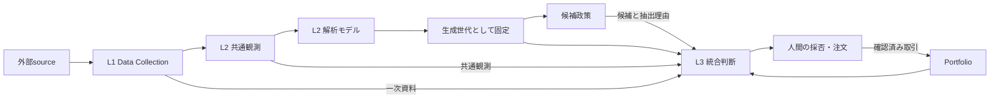
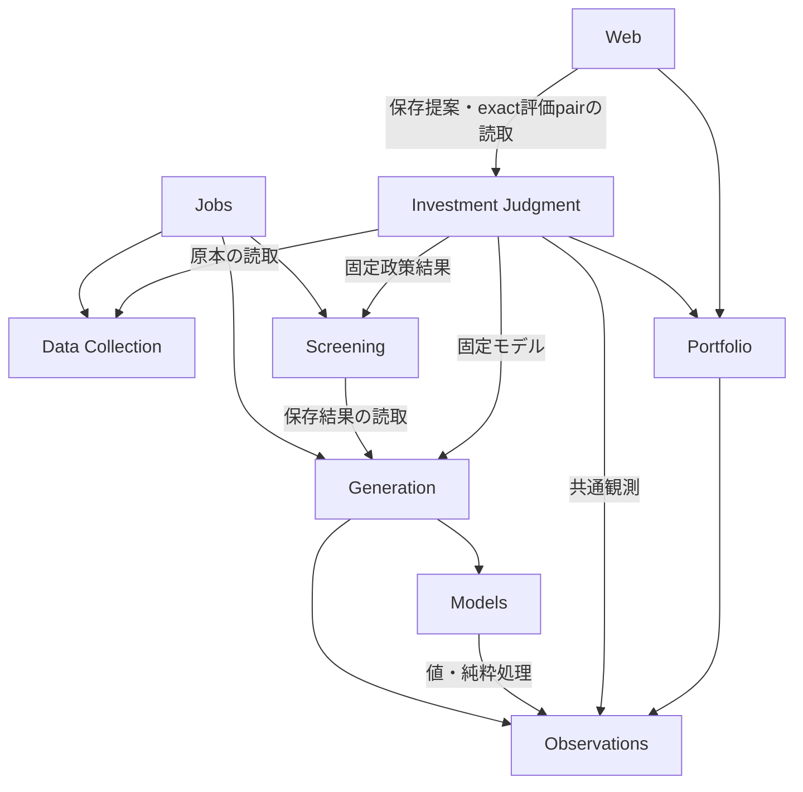

# Architecture

Baibai Loopは、外部から受領した事実と複数の分析観点を統合し、企業の価値と支払価格、リスクと機会損失を比較する。AIは根拠付きの売買提案を作り、最終採否・注文・約定確認は人間が行う。投資・開発の採否基準は[doctrine](doctrine.md)、名称の意味は[用語集](glossary.md)が所有する。

## 情報の流れ

L1は原本またはsource契約で明示したprovider-native表現と受領事実。L2は再現可能な観測・モデル計算・候補抽出。L3は仮定を伴う解釈・評価・判断である。型付き観測は原本の代用品ではなく、仮定を決定的な式で計算してもL2の事実にはならない。

L1〜L3は情報の性質であり、Jobs・エンジン・AI・人間は実行主体の区分である。保存snapshotも情報層ではない。L4や、工程数に合わせた自律agent群は設けない。

## 責務と配置

engineの業務責務は`engine/src/baibai_engine/`に置く。フォルダは「何が変わると一緒に変更するか」で分け、旧名のimport facadeで関係を隠さない。同じ規則をJobs・CLI・表示へ複写せず、所有者の入口へ集める。局所的な理由は所有実装の近くへ残す。[実装と文書の整理方針](documentation.md)を変更時にも適用する。

| 配置 | 所有する責務・境界 |
| --- | --- |
| `data_collection/providers/` | 提供元別の通信とnative契約。分析分野をprovider名と混在させない。 |
| `data_collection/receipts/`・`transport/`・`acquisition/` | 原受領の識別・受渡し、通信手段、L1取得の合成。L2の導出や投資判断は行わない。 |
| `machine_analysis/observations/` | 原本を分析材料へ投影・正規化する。株式、価格、財務、開示、信用・空売り等の取引状況、経済指標、外部評価を区別する。複数分野を含むsource応答の投影は共通入口で束ねる。 |
| `machine_analysis/models/` | 企業財務・企業成長・市場環境・外部評価・テクニカル分析・産業動向・社会動向。特定の問いに答える計算と結果を所有し、候補政策を知らない。 |
| `machine_analysis/generation/` | 入力の固定、モデルに必要な観測の読取、モデル実行、生成世代の保存・読取。計算の途中で別のsourceを取得しない。 |
| `machine_analysis/screening/policies/` | 保存モデルから候補と理由を選ぶ政策。モデル追加と政策変更は別の変更である。政策結果の保存・読取はScreeningが所有する。 |
| `machine_analysis/historical_evaluation/` | 機械モデル・候補政策の歴史評価と必要な旧run読取。過去の機械ER/FV・旧Screening規則を現行モデルや候補政策へ混ぜない。 |
| `investment_judgment/` | 企業調査、銘柄評価、独立検証、売買提案、市場環境判断。`workflow/`は対象固定・進行・再開を所有する。 |
| `portfolio/` | `ledger/`は確認済み取引・資本、`holdings/`は保有状態、`performance/`は運用成果。買付採否や調査の完了条件を所有しない。 |
| `tasks/` | 人間が明示した作業項目と進行状態。 |
| `storage/` | `sqlite/`は実行用DB、`snapshots/`は固定manifest・release、`objects/`はobject転送と条件付き書込。領域の意味や採否を決めない。 |
| `primitives/`・`cli/` | 前者は小さな共通値・純粋変換、後者は引数・表示・終了コードと実行環境の入口。汎用箱に業務規則を逃がさない。 |

snapshotの列・layer・coverage等の定義とSQLite tableの意味は原本／観測のownerが持つ。Storageは明示された定義を使う保存・検証機構であり、公開対象やsource別の受入条件はJobsが合成する。全体hydrate/dehydrateは完全なcatalogとpolicyを必須入力にし、個別の固定読取は必要なownerの契約だけを受け取る。

`jobs/src/baibai_jobs/`は取得・統合・公開・保守・監視を合成する。各domainの算術や保存条件を複製せず、所有者の入口を呼ぶ。`tools/`は開発・診断用で、通常運用の隠れた入口にしない。Webは資産・損益・保有、運用成績、タスク、最新保存提案とexact評価pairの読取を合成し、候補抽出や判断の成功条件には含めない。判断の作成・現在条件の再試算・台帳更新はWebから呼ばない。表示契約は[Web](../web/README.md)が所有する。

上図は主要な依存方向。領域から保存機構・共通値への依存は省略する。CollectionからL2、観測からモデル、モデル生成から候補政策、PortfolioからL3への逆依存は作らない。工程間で必要な保存・再開の合成と、解析モデル内の算術は別に置く。厳密な境界は[依存契約](../pyproject.toml)で管理する。

## モデル追加と候補政策の変更

モデルはScreening専用の中間データではない。L3は候補外の企業も同じ生成世代から調査できる。候補政策は企業財務・企業成長と市場の業種区分から経済経路を計算する。テクニカル・外部評価・共有環境は比較の支持・反対材料として渡し、全モデルを一つの加点表にしない。政策の意味と限界は[Screening](reference/screening-runtime.md)が所有する。

モデルを追加するときは、計算の所有者と生成への組込みを変更する。候補にどう効かせるかは別に政策として決める。モデル数を固定したL3の一覧で結果を捨てず、個社・業種・市場の結果をそれぞれの対象とともに渡す。同じ価格情報を複数モデルが使うことは、独立した複数の根拠を得たこととは限らない。

産業動向と社会動向は、原受領と別のimmutable抽出artifactから生成する。Observationsが主張の帰属・範囲・否定・条件・精度と原文座標を所有し、モデルは比較可能な差分を計算する。産業の共有subjectはversion付き業界定義、社会は薄い市場共有結果を使う。個社には既存5モデルを維持し、共有subjectを銘柄数や候補政策へ混入させない。本文は固定releaseのexact参照へ分け、旧引用のlineage releaseと保持中のlookup releaseを区別する。

記事の有限選択はObservations readerが担当し、Generationは固定選択から両共有モデルの入力と銘柄への関連を組み立てる。個社への対応が未確認の業界subjectを推測で銘柄へ付けず、原典の対象除外・母集団・出典を保持する。具体的な選択と対応は[生成owner](../engine/src/baibai_engine/machine_analysis/generation/)から辿る。

生成世代は、その世代の対象・予定モデル・関連する共有文脈を固定する。これは重み付けや実行DAGではなく、未生成と生成結果内の欠測を区別するための契約である。L3のsliceは対象企業と必要な共有文脈だけを持ち、再開時に新しいモデル一覧や既定fieldを補わない。保存identityと公開時の原入力を保持し、明示移行後の通常再開と過去の出典照合は[運用手順](../jobs/OPERATIONS.md#financials-identity-cutover)で区別する。

## 判断と進行

Company Researchは一次資料から事業・財務・競争力・経営を調べる。Stock Assessmentは調査と機械観測を統合し、価値・価格・成立条件・リスクリワードを評価する。Independent Reviewは作者と独立して根拠・仮定・算術・反証を検証する。Trade Proposalは検証された評価を価格・cash・保有へ適用する。これらは無リスク認定や、全事実の完全証明を意味しない。

`investment_judgment/judgment_retrospective/`は特定の旧判断と後日根拠の照合・学びをapplication DBへ保存し、企業知識の更新・現在評価・Portfolioの損益・機械手法の歴史較正とは分ける。

解釈と判断はAI、算術・保存・状態管理はエンジンが担当する。Selectionは人間が明示した有限対象・問い・入力を固定する。不足や反証があれば調査・評価へ戻り、工程名だけを理由に必須DAGや承認を増やさない。市場全体の判断は個別企業から独立した入口を持つ。

Operation完了、提案公開、人間の採用、注文、約定は別の状態である。確認済み取引の記帳を現在の候補政策へ従属させない。操作と完了・再開の手順は[投資判断](../.agents/skills/investment-judgment/SKILL.md)、[市場判断](../.agents/skills/market-context-assessment/SKILL.md)、[取引事実の記録](../.agents/skills/ledger-record/SKILL.md)が所有する。

## 保存責務

データ状態の正本はクラウドにあり、認可された実行環境とActionsが更新する。作業コピーと正本を区別し、世代を照合して反映する。

| 保存単位 | 役割 |
| --- | --- |
| application DB | 部分的な企業調査・判断・Review・提案・Selection・Operation・task・台帳の正本。 |
| 固定snapshot | L1原本とL2投影を含むimmutable object・manifest。readerは一つのreleaseを固定する。 |
| source cache SQLite | 原本・投影と取得coverage等を持つ実行用コピー。source単位の部分copyと全体releaseのcopyは別である。 |
| native source SQLite | 経済等のnative原本・受領・取得記録。必要な観測は固定した読取から導出する。 |
| runs SQLite | 再生成可能なモデル世代・候補政策結果と、必要な旧run。 |
| calibration directory | 再生成可能な歴史評価snapshot。runs DBとは別の保存単位。 |

通常のsource取得は担当範囲のread-only inputから原受領handoffを作り、全体正本を直接更新しない。共通統合は開始時点で受入対象となるimmutable handoffを固定し、全sourceの完了を待たずに各ownerの投影を適用する。同じ入力からモデル生成・候補保存を終えてからreleaseを公開する。原本受領の成功とL2投影の成功を一つにしない。部分copyへ全体releaseの所属情報を付けない。

取得の起動時刻、対象期間、実受領時刻、公開時刻は別である。再実行の充足条件は保持済みの原受領とその要求範囲で判断し、L2の欠測を埋めるために取得済み原本を取り直さない。具体的なcycle・再開単位・予算はsource ownerが持ち、[sourceの入口](reference/data-sources.md#source-owners)と[運用](../jobs/OPERATIONS.md#actions-write-boundary)から辿る。

現行のhandoff契約は全source共通ではない。記事は未処理workと未統合stage、TradingViewは当日要求の充足、公開HTML外部評価は固定planとconfirmed readyをそれぞれ保持する。外部評価の通常readyは全固定pairの試行完了を必要とし、明示した部分公開後のterminalはそのplanを閉じる。全sourceが任意の途中成果を継続公開・再開できるという保証ではない。未実装の共通化は企画Issueへ分け、実装済みの正本・再開条件を上書きしない。

L3は必要なモデル断面・政策結果をapplication DBへ複写し、再開時に可変storeから再計算しない。生成cacheと政策結果の整理はJobsが参照順とtransactionを束ね、生成側に候補政策の削除責務を持たせない。原本・判断・取引履歴はcache整理の対象ではない。

module名・CLI名と保存identityは別の契約である。既存のobject key、table、保存path、model ID、JSON field、hash、参照・履歴は配置変更だけで書き換えない。既存のlake namespaceも固定snapshotの保存契約として維持する。価格日・観測期間・公表日・受領cutoffを区別し、固定snapshotをintraday point-in-time再現の保証と扱わない。

原本bytes・受領日時・source identity、nullと0、既知の不足を保持する。規則の意味変更は新revisionとし、配置変更だけで意味revisionを更新しない。過去計算の再現には当時のコードと入力も必要であり、古い実装を現行経路へ復活させない。

取得・発行・復旧と明示的なローカル運用は[OPERATIONS](../jobs/OPERATIONS.md)、開発環境と検証は[development](development.md)、文書の統合・削減は[文書ルール](documentation.md)に従う。
