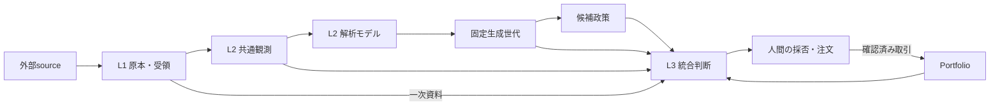

# Architecture

Baibai Loopは受領事実と複数の分析観点から、企業価値・価格・リスク・機会損失を比較し、根拠付きの売買提案を作る。最終採否・注文・約定確認は人間が行う。採否基準は[doctrine](doctrine.md)、名称は[用語集](glossary.md)、操作は[OPERATIONS](../jobs/OPERATIONS.md)を参照する。

## 情報の流れ

L1は原本または明示したprovider-native表現と受領事実、L2は再現可能な観測・計算・候補抽出、L3は仮定を伴う解釈・評価・判断である。typed観測は原本を代替せず、仮定の決定的な算術もL2の事実にはならない。情報層をJobs/エンジン/AI/人間という実行主体やsnapshotと混ぜず、L4や工程数に合わせたagent群を設けない。

L2はL1と明示設定から再生成し、前回L2を正本/必須入力にしない。取得をL2結果へ従属させず、cursor・進捗は原本と別の運用状態として、消失時の再取得条件を持つ。過去DB復元/監査だけの中間DB蓄積はしない。残る逆依存は移行対象であり、未移行原本・判断・取引を削除可能と扱わない。

## 責務と配置

業務ownerは `engine/src/baibai_engine/` に置き、一緒に変わる規則・型・理由・testを近づける。CLI/Jobs/Webや旧import facadeへ規則を複写せず、[整理方針](documentation.md)に従う。

| 配置 | 責務 |
| --- | --- |
| `data_collection/` | `providers/`は提供元の通信/native契約、`receipts/`は受領の識別/受渡し、`transport/`は通信手段、`acquisition/`はL1取得の合成。分析分野とproviderを混ぜない。 |
| `machine_analysis/observations/` | 原本の投影・正規化。複数分野を含む応答は共通入口で束ねる。 |
| `machine_analysis/models/` | [七種のモデル](glossary.md#現在の解析モデル)ごとの問い・計算・結果。候補政策を知らない。 |
| `machine_analysis/generation/` | 入力/対象の固定、必要観測の読取、モデル実行と世代の保存/読取。途中で外部取得しない。 |
| `machine_analysis/screening/` | 保存モデルから候補/理由を選ぶ`policies/`と、その結果の保存/読取。 |
| `machine_analysis/historical_evaluation/` | 機械手法の歴史評価と必要な旧run。旧ER/FV・Screening規則を現行政策へ混ぜない。 |
| `investment_judgment/` | 調査・評価・独立検証・提案・市場判断。`workflow/`は対象固定・進行・再開。 |
| `portfolio/` | `ledger/`の確認済み取引/資本、`holdings/`の保有、`performance/`の成果。採否/調査完了は所有しない。 |
| `tasks/` | 人間が明示した作業と進行。 |
| `storage/` | `sqlite/`の実行DB、`snapshots/`の固定manifest/release、`objects/`の転送/条件付き書込。領域の意味は決めない。 |
| `primitives/`・`cli/` | 小さな共通値/純粋変換と、引数/表示/終了コードの入口。業務規則の汎用箱にしない。 |

保存契約は原本/観測ownerが持ち、Storageは保存・検証機構、Jobsは公開対象とsource別受入の合成を担う。全体hydrate/dehydrateには完全なcatalog/policy、個別固定読取には必要なowner契約を渡す。

`jobs/src/baibai_jobs/`は取得・統合・公開・保守・監視を合成し、算術/保存条件を複製しない。`tools/`は開発・診断用で通常運用を隠さない。[Web](../web/README.md)は資産・成果・task・保存提案/exact評価pairの読取に限り、判断作成・現在再試算・台帳更新や候補抽出の成功条件を持たない。

CollectionはL2、観測はモデル、生成は候補政策、PortfolioはL3へ逆依存しない。モデル内算術と工程間の保存/再開を分ける。具体的な許可importは[依存契約](../pyproject.toml)を正本とする。

## モデル追加と候補政策の変更

モデルはScreening専用ではなく、候補外も同じ世代からL3へ渡せる。モデル追加と生成への接続、候補政策の変更を分ける。現政策は企業財務・成長・業種から経済経路を計算し、テクニカル・外部評価・共有環境は支持/反対材料として扱う。全モデルを加点表にせず、同じ価格等を独立根拠へ増やさない。意味は[Screening](reference/screening-runtime.md)が所有する。

個社5モデルに加え、産業/社会動向は原受領と別のimmutable抽出artifactから生成する。主張の帰属・範囲・否定・条件・精度・原文座標と記事の有限選択はObservations、比較可能な差分はモデル、入力と銘柄への関連づけは[Generation](../engine/src/baibai_engine/machine_analysis/generation/)が所有する。産業はversion付き業界定義、社会は薄い市場共有subjectを使い、銘柄数/候補政策へ混入させない。未確認の業界対応を推測せず、対象除外・母集団・出典を保つ。本文はexact参照に分け、元引用のlineage releaseと保持中のlookup releaseを区別する。

世代は対象・予定モデル・共有文脈を固定し、未生成と結果内の欠測を区別する。重み付けや実行DAGではない。L3は対象企業と必要文脈だけを切り出し、再開時に新モデル一覧・既定fieldを補わない。保存identity/原入力を保持し、移行後の通常再開と過去出典照合は[運用](../jobs/OPERATIONS.md#financials-identity-cutover)で分ける。

## 判断と進行

一次資料によるCompany Research、価値/価格のStock Assessment、作者と独立した根拠・仮定・算術・反証のIndependent Reviewを経て、検証済み評価を価格・cash・保有へ適用したTrade Proposalを作る。無リスク認定や全事実の完全証明ではない。解釈はAI、算術・保存・状態管理はエンジンが担う。

Selectionは人間が明示した有限対象・問い・入力を固定する。不足/反証は調査・評価へ戻し、工程名から必須DAGや承認を増やさない。市場判断は個社と独立した入口を持つ。`judgment_retrospective/`は旧判断と後日根拠の照合/学びをapplicationへ保存し、企業知識・現在評価・資産損益・機械較正と分ける。

Operation完了・提案公開・人間の採用・注文・約定は別状態で、確認済み取引の記帳を候補政策へ従属させない。操作は[投資判断](../.agents/skills/investment-judgment/SKILL.md)・[市場判断](../.agents/skills/market-context-assessment/SKILL.md)・[記帳](../.agents/skills/ledger-record/SKILL.md)を参照する。

## 保存責務

クラウドを正本とし、認可された実行環境/Actionsが作業copyと世代を照合して更新する。

| 保存単位 | 役割 |
| --- | --- |
| application DB | 部分調査・判断・Review・提案・Selection・Operation・task・台帳の正本。 |
| native L1 | source別の可変headと不変body/request pack。受領記録と同値body共有を区別する。 |
| 共有固定入力 | 採用原本と確認/失敗状態のmetadata。generation/Selectionが参照し本文は複写しない。 |
| 固定lake snapshot | L2と未移行L1のimmutable object/manifest。読取releaseは一つに固定する。 |
| source cache SQLite | marketの実行copy。未移行原本/運用状態もあり全体は廃棄可能cacheではない。 |
| native source SQLite | 経済等の原本・受領・取得記録。観測は固定読取から導出する。 |
| runs SQLite | 再生成可能なモデル世代/候補政策結果と必要な旧run。 |
| calibration directory | runsと別の再生成可能な歴史評価snapshot。 |

原本受領とL2公開は別の成功境界。独立L1はL2成功を待たず取得/公開し、モデル/公開L2は開始時の入力を固定する。保存入力の再現を最新headへ読み替えない。未移行sourceも同じ取得/再開条件とは限らず、[取得元](reference/data-sources.md#source-owners)と[運用](../jobs/OPERATIONS.md#actions-write-boundary)で確認する。

L2は必要投影と不変object/metadataを再利用し、原本本文や全履歴を毎日複写しない。ただしcold再生成の実装済み範囲と旧release依存を分ける。共有固定入力/参照原本はruns cacheと別寿命で、保存判断の入力再計算に必要な間は保持する。L3は必要モデル断面/政策結果をapplicationへ複写し、再開時に可変storeから再計算しない。Jobsの生成cache/政策整理とローカルlake GCは、原本・判断・取引履歴・R2の削除ではない。

経済の固定入力は[経済generation owner](../engine/src/baibai_engine/machine_analysis/generation/economic_inputs.py)の明示APIで作成・再計算する。原本のPK・内容digest、採用済みperiodと文書、当時のconfirmation・最新runの不在/失敗を固定し、本文は現行経済L1に残す。期間metadataを共有し、FREDの同値確認clockだけで全月を複写しない。TradingView補助文脈は無効・失敗を含む上位201受領を固定する。冷再計算は当時と同じengine/config/runtimeを要求し、後日訂正や新しい採用状態へ置き換えない。原本欠落は再計算失敗であり、当時の欠測ではない。

経済固定入力v2のnative期間はReadingと同じ規則から取り、derivedの再帰・月初拡張と共有sourceの窓を合成する。flowsは観測期間ではなく公表cutoff以前の全原本、Matsui/PMI等の文書は窓外の不正・訂正も結果に影響するため全latestを保つ。全体collectionの確認digestはprovenanceに残し、部分projectionを完全collectionとは扱わない。capture時のFRED全体整合検証は引き続き全anchorを読むため、一律のbounded I/O保証ではない。v1を新しい窓へ黙って読み替えない。

通常Generationもこの経済固定入力から計算し、market seal後に固定した評価時刻・対象日を入力と共有する。日次の経済DB全体copyとhash-only identityは作らず、原本は既存の経済正本`indicators.sqlite`、共有metadataは`fixed-inputs/economic/`に残す。冷再計算は保存Generationのeconomic identityと保持中の原本から同じ文脈を作り、計算用の一時projectionを公開・mergeしない。旧`sqlite_snapshot`世代の保存結果は読めるが、hashだけから失われた旧DBを復元したりnative固定入力へ昇格させたりしない。原本のobject別取得・全Generationのexact再生・過去の市場PITは保証せず、実データの保持・容量・時間確認は #1820 に残る。

module/CLI名と保存identityは別契約。配置変更でkey/table/path/model ID/JSON/hash/意味revisionを変えない。原本bytes・受領時刻・source identity、null/0・既知の不足と、価格日/対象期間/公表日/cutoffを保持する。固定snapshotはintraday PITを保証せず、過去再現には当時のcode/入力も必要。古い実装を現行経路へ復活させない。環境と検証は[development](development.md)、文書整理は[documentation](documentation.md)へ進む。
